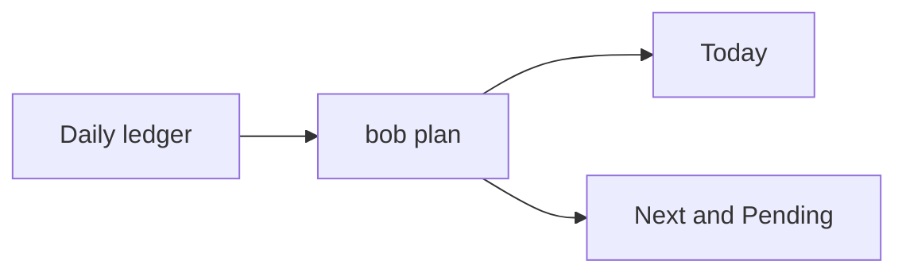

# Plan budget

This concept explains the plan budget: what it is, how it fits Bob's command-line
tool, plugins, and vault, and when to think about it. The contract is docs/plan.md.

## The idea in one picture

The daily note's Pomodoro ledger feeds `bob plan`. Today is the open tasks with a
dedicated Task Link under today's open Pomodoros. Next and Pending are lane counts
from the Tasks index.

## How it works

Themes are the distinct open Pomodoro names besides the exempt ones. Links are the
distinct Task Links under those entries. Caps are configuration; the command is
read-only and does not change lanes. Link to a guide for the command and to
docs/plan.md for exact behavior.

## When it matters

Inspect the budget before capturing more Task Links into today's ledger, and again
after a reconcile, when the counts should match the ledger you just edited.

## Related

- [Getting started](../getting-started.md)
- [Plan budget, Today, and lanes](../plan.md)
