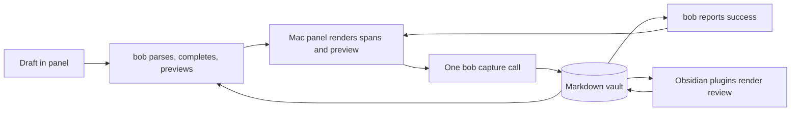

# How Bob fits together

The vault owns the state. The CLI owns capture grammar, planning, and vault writes.
Obsidian plugins render the desktop review and write review gestures directly, and
Mac Capture is a sibling program that submits drafts through the CLI.

## The idea in one picture

A draft travels one round trip: the panel sends text, `bob` returns spans,
candidates, and a preview, the panel renders them, one submit writes the
vault, and `bob` reports success back to the panel before it hides. Obsidian
reads the same vault afterward and writes review gestures directly.

## Who owns what

Markdown files in one folder are the whole system. Area and project notes
hold tasks, the daily note holds the Pomodoro ledger, and references hold
reading. Nothing else is authoritative.

`bob` plans every capture against in-memory snapshots and writes all or
nothing. It computes Today from Task Links under open Pomodoros at read
time; lanes stay sticky except derived Blocked, and freshness never changes
a lane. The contracts beside this page specify the exact behavior.

Obsidian plugins render cards, badges, the review walk, and the Task Card,
and they write Markdown directly for review gestures: lane moves, dependency
edits, and freshness stamps go through the shared stamper into the vault.
They do not replace capture semantics, but only Mac Capture is governed by
the thin-client rule. See
[Bob Mac Capture Is A Thin Client Of bob](../develop/decisions.md#mac-capture-is-a-thin-client).

Mac Capture owns presentation, the hotkey, settings, and packaging. It never
parses capture grammar and never writes the vault directly: it runs `bob`
for spans, candidates, and previews, submits one `bob capture` per draft,
and only hides after `bob` reports success. For the agenda it never reads
the vault directly either; it asks `bob capture-pomodoros --tasks` and
paints what comes back.

## Related

- [Understand Bob](index.md)
- [Glossary](../reference/glossary.md)
- [Design decisions](../develop/decisions.md)
