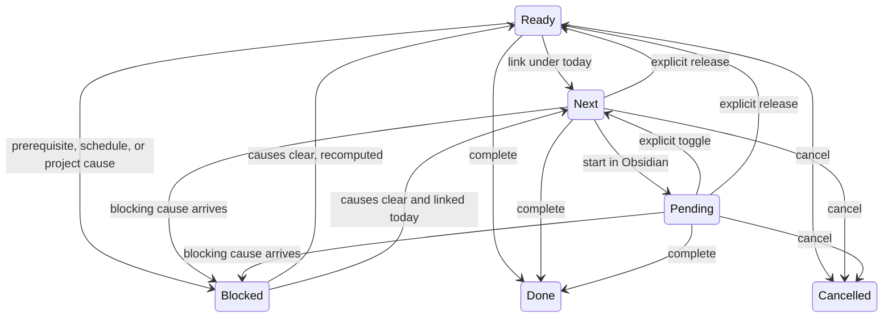

# Tasks and lanes

This concept explains what a task is in Bob, what each lane means, and when work moves between lanes.

A task is one actionable Markdown checkbox in an area, project, or inbox note. Its note gives the work context, and a trailing block ID (for example `^fix-drainage`) gives links a stable target. A block ID is not required on every newly captured task; capture mints one when a task needs to be linked, and links resolve through the vault's ordinary block links.

```bob-task
- [ ] #task Harden the cold frame before the frost ^harden-frame
- [*] #task Order seed-starting mix ^seed-mix
- [/] #task Label the seedling trays ^label-trays
```

The demo vault's `garden.md` area note and `Projects/seedlings.md` project note hold tasks exactly like these: one line per commitment, with the note deciding where the work lives.

## The lanes

The checkbox is the lane. Bob uses six:

| Checkbox | Lane | Meaning |
| --- | --- | --- |
| `[ ]` | Ready | Confirmed work waiting to be chosen. |
| `[*]` | Next | Explicitly committed work. |
| `[/]` | Pending (In Progress) | Work started in Obsidian. The Tasks status name remains In Progress. |
| `[?]` | Blocked | Derived: waiting on a prerequisite, a future schedule, or a blocked project. |
| `[x]` | Done | Completed work. |
| `[-]` | Cancelled | Dropped work. |

Do not confuse the Ready lane with the freshness-gated READY view. The lane is what the checkbox says; the READY view is a review-time subset of visible work that excludes the NEW and ROTTEN review buckets. Whole-lane pressure stays visible even when some rows are held out for review. Lane, Today, freshness state, and review tier are different dimensions: changing one never implicitly rewrites another.

## Sticky commitments

Next and Pending are sticky. An eligible link promotes Ready to Next, and an in-progress close outcome puts work in Pending. Unlinking does not release either lane: removing a Task Link, running a hooks pass, or deleting a ledger line leaves Next and Pending where they are. Only an explicit release returns Next or Pending to Ready, and that release also removes the task's live links from today's open Pomodoros. The existing explicit Next/Pending toggle moves a linked task between those two lanes without touching Today.

## Capture makes a task

Capture is the usual way a task comes into being. A short draft in the terminal or the Mac panel becomes one inbox line, with creation metadata attached, and later review moves it to the note where it belongs. Grammar details, including prerequisite and completion gestures, live in the capture contract; this page only sets the mental model: capture proposes the task, the note holds it, and links point at it.

## Derived blocking and recovery

Blocked is derived, never authored. It follows from open prerequisites on the task's managed Depends-On line, a future scheduled date, or project inheritance from the note's `^prj` task. A hand-set Blocked checkbox alone is not a project blocking reason; reconcile recomputes the marker from causes on every pass.

Recovery recomputes an eligible lane rather than restoring a hidden previous status. When the blocking cause clears, the task returns to the lane its current inputs justify: Ready unless it is linked into today or carried by recent activity. There is one narrow exception for tasks that live in a canonical daily note or the selected current ledger, which keep today's derived clearing behavior even when they would otherwise stay sticky. The contracts own that edge case.

## The main transitions



This diagram summarizes the main transitions. Today and freshness never appear as states: they select which tasks are reviewed or planned, but they do not change the checkbox. Every Blocked recovery arrow means recomputation from current causes, not restoration of a saved previous status. Prose above is sufficient without the picture; the picture only compresses it.

## Related

- [Your first Bob day](../start/first-bob-day.md) — capture a task and see its lane change.
- [Understand Bob](index.md) — the eight nouns and where lanes fit.
- [Projects and dependencies](projects-and-dependencies.md) — what derives Blocked.
- [Today and the Pomodoro ledger](today-and-the-pomodoro-ledger.md) — how linking selects work without changing commitment.
- [Vault format](../reference/vault-format.md) — task-line anatomy, lanes, and fields.
- [Plan budget, Today, and lanes](../plan.md) — the authoritative lane and budget definitions.
- [Task Status Hooks](../task-status-hooks.md) — how reconcile derives Blocked and keeps sticky lanes.
