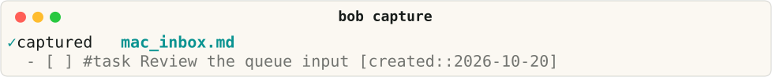

# Bob

**Capture a thought. Choose today's work. Keep an honest record.**

Bob is a Rust command-line tool with Obsidian plugins for planning and review, plus an
optional Mac menu-bar panel for capture. The vault stays in Obsidian and syncs through
Git; the Mac panel only submits drafts and never owns the workflow.

Linux and macOS · Obsidian

[Is Bob for me? Start with Get started](start/is-bob-for-me.md).
[Read the behavior contracts](develop/contracts.md).

## One thought · three surfaces · one vault

<div class="bob-home-cards" markdown="1">

**Terminal.** Type the capture and see the inbox line it writes.

```bash
bob capture "Review the queue input"
```



The inbox note holds `- [ ] #task Review the queue input [created::2026-10-20]`,
verified against a synthetic scratch vault with a fixed clock.

**Obsidian.** The same line renders as a task card. Commands, settings, and
extra keyboard behavior live in the [Obsidian plugins](reference/plugins/index.md)
reference.

```bob-task
- [ ] #task Review the queue input [created:: 2026-10-20]
- [*] #task Fix the parser crash [scheduled:: 2026-10-21]
- [x] #task Ship the queue filter [completion:: 2026-10-19]
```

**Menu bar.** The optional Mac panel shows the mark and today's queue.


Read the [Mac Capture reference](reference/mac-capture/index.md). The panel is illustrative; the media phase owns the real screenshot.

</div>

## A Bob day

[Morning review](concepts/freshness-and-the-review-walk.md) clears the queue,
[capture](concepts/tasks-and-lanes.md#capture-makes-a-task) takes the next thought,
[Pomodoros](concepts/today-and-the-pomodoro-ledger.md) hold today's work,
[close](concepts/projects-and-dependencies.md#finishing-a-prerequisite) finishes work
and chooses what comes next, and [sync](concepts/why-the-vault-syncs-through-git.md)
keeps the vault honest.

## Doors

<div class="bob-doors" markdown="1">

**Do.** Complete a goal.

- [Guides](guides/index.md) for install, capture, review, sync, and recovery.
- [Add prerequisites while capturing](guides/add-prerequisites.md)
- [Sync the vault across machines](guides/sync-vault-across-machines.md)

**Learn.** Follow the tested path.

- [Get started](start/index.md) for the first day, installs, and continuations.
- [Understand Bob](concepts/index.md) for the nouns and the system diagram.

**Develop.** Build and maintain the site.

- [Build the docs](develop/build.md)
- [Writing docs](develop/writing-docs.md)
- [Behavior contracts](develop/contracts.md)

**Look up.** Reference that never drifts from the tools it describes.

- [Look up Bob](reference/index.md) for the CLI reference, glossary, and compatibility.

</div>

## Source

Bob lives in three public repositories: [bob-cli](https://github.com/bobs-org/bob-cli),
[bob-plugins](https://github.com/bobs-org/bob-plugins), and
[bob-mac-capture](https://github.com/bobs-org/bob-mac-capture), under the
[MIT license](https://github.com/bobs-org/bob-cli/blob/master/LICENSE).

New here? [Is Bob for me?](start/is-bob-for-me.md) ·
[Requirements and compatibility](reference/compatibility.md).
